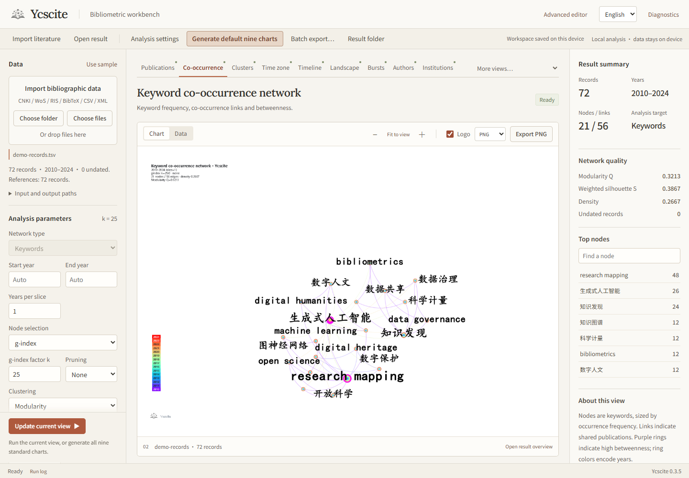

<p align="center"></p>

# Ycscite · Bibliometric workbench

[中文](README.md) · [User guide](docs/USER-GUIDE.en.md) · [CLI / headless](docs/HEADLESS.md) · [Methods and capabilities](docs/CAPABILITIES.md)

Import literature locally, choose the individual view you need, and export charts with auditable data. The Windows desktop app, browser workbench, Rust CLI, and GUI-free NDJSON service share one configurable analysis engine.

The nine-chart preset covers publications, keyword co-occurrence, clusters, time zones, timelines, landscapes, bursts, authors, and institutions. Nine additional views are independently selectable: network overview, circular layout, heatmap, t-SNE, UMAP, circle packing, thematic map, contours, and observed journal citation flows.

Features include import diagnostics, 13 named input formats, 10 network types, 3 clustering algorithms, 6 labelers, reusable JSON settings, optional analytical tables, bilingual controls/captions, and downloadable PNG/SVG/PDF variants with or without the user-provided brand mark. Original bibliographic labels remain in their source language.



## Get started

Download `Ycscite-0.3.3-windows-x64.zip` from Releases and extract the **entire folder**. Launch `Ycscite.exe` or use the browser launcher. Select an individual view and run it; batch export is a separate explicit action. A compact Java 21 runtime is included; the desktop shell uses system Edge WebView2. CLI/headless need neither a browser nor WebView2.

```powershell
.\ycscite-cli.exe --json doctor
.\ycscite-cli.exe inspect "D:\literature" --json
.\ycscite-cli.exe report "D:\literature" --out "D:\report" --json
.\ycscite-cli.exe analyze "D:\papers.bib" --network author --charts network,circular --lang en --out "D:\authors"
.\ycscite-cli.exe config --out settings.json
.\ycscite-cli.exe headless --request examples/request.json
.\ycscite-cli.exe batch examples/batch.json
```

In the app, **Use sample** loads 72 fictional records. Choose a view, adjust the left-hand parameters, run it, and inspect the chart or data. **Batch export** explicitly selects multiple views. The **Logo** switch selects an existing variant without erasing chart pixels. **Advanced editor** preserves the separate node-editing interface.

## Build

JDK21+ and stable Rust are required. Windows desktop builds also need the MSVC build tools.

```powershell
.\build.cmd
cargo test --manifest-path native/Cargo.toml --locked
cargo build --release --manifest-path native/Cargo.toml --locked
native\target\release\ycscite.exe serve
powershell -ExecutionPolicy Bypass -File tools/package-windows.ps1
```

Use `bash build.sh` for the Java engine on Linux/macOS. CLI/Web can be built with Cargo on those systems; the distributed desktop target is Windows x64. Rust provides the client and local service; Java21 provides analysis and rendering. The algorithms have not all been rewritten in Rust.

## Scope and methods

Ycscite is not affiliated with CiteSpace and does not promise identical clusters, bursts, layouts or pixels. Simplified and experimental analyses are identified in the capability inventory and method notes. Community detection is not probabilistic topic modeling. References, proprietary basemaps and user datasets are not bundled.

Data and default analysis remain local. Advanced online search and explicitly configured remote-model tools contact their corresponding services only when invoked. See the [method inventory](docs/CAPABILITIES.md), [protocol](docs/HEADLESS.md), and [development guide](docs/DEVELOPMENT.md).

The local workspace remembers language, analysis settings, input paths, the active view and result across restarts and port changes. Web/desktop runs use separate result subdirectories. Parsed-record SHA-256 identities in `inspect` and manifests detect changed source data; existing images remain available as explicitly marked historical results.

Editable `.csl-proj` files retain the included corpus, full analysis options, exact network and manual annotations. Download the current network as an Editable project or open it in the advanced editor; changed settings are passed to the editor rather than replaced with its older defaults. Versioned record TSV preserves multivalue content and control characters.
