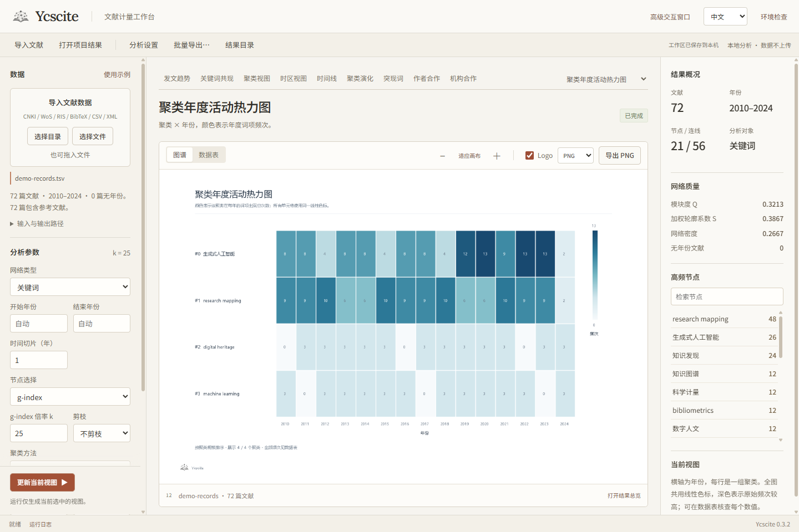

<p align="center"></p>

# Ycscite · 文献分析工作台

[English](README.en.md) · [使用指南](docs/USER-GUIDE.zh.md) · [CLI / headless](docs/HEADLESS.md) · [方法与能力](docs/CAPABILITIES.md)

把文献数据导入本机，直接选中需要的图谱，运行并查看可核查的数据表。Ycscite 提供 Windows 桌面应用、浏览器工作台、命令行和无需图形环境的 NDJSON 接口；所有入口共用分析引擎与参数。

- **九种常用视图**：年度发文量、关键词共现、聚类、时区、时间线、演化山峰、突现、作者合作、机构合作。九图保持独立、稳定的绘制流程。
- **可选扩展**：网络总览、环形、聚类年度活动热力图、t-SNE、UMAP 近似结构嵌入、聚类圆形打包、主题战略图、聚类活动等值线、期刊引文流，共 18 种图型。
- **直接操作**：左侧设置、中央图谱、右侧指标与节点。常用图直接切换；扩展图在「更多视图」中独立选择。修改参数会标记已有结果待更新；已生成的单图可切回查看。
- **工作区恢复**：语言、参数、数据路径、当前视图和结果自动保存在本机；重启无需重设。Web/EXE 每次运行使用独立结果目录，保留历史。数据内容变更会提示重新分析。
- **可调参数**：时间切片、g-index / Top N / Top N%、网络类型、剪枝、相似度、聚类与标注、排除词、突现参数、节点与标签大小、连线透明度、导出清晰度。
- **导入预检**：自动识别多种格式，检查年份、关键词、作者、机构和参考文献的覆盖；支持混合目录、UTF-8 / UTF-16 与常见中文历史编码。
- **输出可复用**：PNG、离线 HTML、数据表、JSON 参数与清单；可额外输出 SVG、PDF、DOCX、SQL、Pajek、GEXF、RIS。PNG / SVG / PDF 提供带 Logo 和无 Logo 两种版本。
- **中文 / English**：界面与通用图题可切换；文献题名、作者和关键词保留原文。



## Windows 便携版

从 Releases 下载 `Ycscite-0.3.2-windows-x64.zip`，**完整解压**后双击 `Ycscite.exe`。选择文献目录或点击「使用示例」，选中所需图谱，再点击「运行分析」。一次运行只生成当前图；「批量导出」可自行勾选多图。

包内附带精简 Java 21 运行时，无需配置 Java。桌面窗口使用系统 Microsoft Edge WebView2 Runtime。也可以运行 `打开Web工作台.cmd` 在默认浏览器使用；CLI/headless 不需要 WebView2 或浏览器。

```powershell
.\ycscite-cli.exe --help
.\ycscite-cli.exe --json doctor
.\ycscite-cli.exe inspect "D:\文献目录" --json
.\ycscite-cli.exe report "D:\文献目录" --out "D:\九图报告" --json
.\ycscite-cli.exe analyze "D:\文献.ris" --network author --charts network,circular --out "D:\合作网" --lang en
.\ycscite-cli.exe serve
```

## 自动化与参数复用

```powershell
.\ycscite-cli.exe config --out settings.json
.\ycscite-cli.exe report "D:\文献" --config settings.json --no-logo --set g_index_k=15 --out "D:\结果" --json
.\ycscite-cli.exe headless --request examples/request.json
.\ycscite-cli.exe batch examples/batch.json
```

`headless` 不带 `--request` 时读取标准输入：每行一个 JSON 请求、每行一个 JSON 响应，进度仅写到标准错误。`report --json` 同样保证标准输出是一份结构化结果。参数与格式错误可独立定位，不需要桌面弹窗。

`engine` 子命令保留已有完整分析 CLI（87 项以上选项），例如 `engine analyze ... --sva --main-path --svg`；`workbench` 打开可编辑节点的高级交互窗口。完整用法见 [headless 协议](docs/HEADLESS.md)。

## 从源码构建

需要 JDK 21+、Rust stable 和 Windows C++ Build Tools。Windows 脚本会探测 `YCSCITE_JDK`、`JAVA_HOME` 与 PATH；可用 `tools/build-java.ps1 -Jdk <路径>` 显式指定。

```powershell
.\build.cmd
cargo test --manifest-path native/Cargo.toml --locked
cargo build --release --manifest-path native/Cargo.toml --locked
native\target\release\ycscite.exe serve
powershell -ExecutionPolicy Bypass -File tools/package-windows.ps1
```

Linux/macOS 可用 `bash build.sh` 构建 Java 引擎，CLI/Web 模式通过 Cargo 构建；桌面 EXE 发布目标是 Windows x64。Linux 与 Windows 构建由 CI 检查；macOS 提供源码构建入口，尚未在本轮独立验证。窗口行为以 Windows 实测为准。

项目结构：`src/ycscite` 分析与绘图引擎，`native` Rust CLI/本地服务/桌面窗口及 Web UI，`test` 回归用例，`examples` 可公开的合成文献，`docs` 方法与自动化文档。Rust 客户端与 Java 分析引擎共同组成当前应用，**尚非全 Rust 算法实现**。

## 方法与数据

图形和表格反映当前输入及设置，不宣称与 CiteSpace 在聚类、布局、突现或像素上完全相同。年度增长、参考文献分散度、实验性引文路径与启发式摘要均有明确的方法说明。图形社区不等同于 LDA 主题模型；可选扩展不会改变默认九图的含义。

分析结果保存在本机。CrossRef / OpenAlex 搜索或用户显式配置的远程模型仅在调用对应高级功能时联网。应用不附带 CiteSpace JAR、原版底图或用户研究数据。可选自备期刊底图见 `resources/jcr/README.md`。

[方法、限制与验证范围](docs/CAPABILITIES.md) · [参考项目能力对照](docs/EXTENSIONS.md) · [构建与发布](docs/DEVELOPMENT.md)
